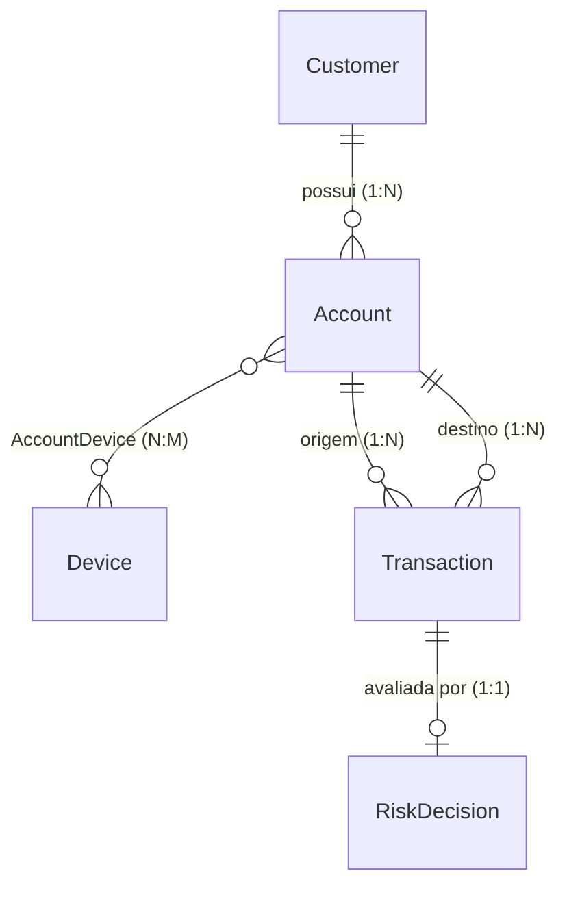

# Modelo canônico de dados

O modelo canônico é a representação neutra das entidades do sistema, independente de PostgreSQL (JPA) e de Neo4j. O integrador traduz **PostgreSQL → canônico → Neo4j** e o caminho inverso, de modo que nenhum dos dois bancos precise conhecer o outro.

## Convenções

- **IDs:** UUID (v4), gerados pelo integrador na primeira vez que uma entidade é vista. A relação com o ID do PostgreSQL está em [mapeamento-ids.md](mapeamento-ids.md).
- **Datas:** ISO-8601 em UTC (ex.: `2026-11-27T14:03:22Z`).
- **Dinheiro:** `amount` como decimal em texto (ex.: `"1500.00"`) para não perder precisão, mais `currency` em ISO-4217 (ex.: `BRL`).
- **Nomes:** campos em `camelCase`, em inglês, iguais aos usados no grafo ([modelo-grafo.md](modelo-grafo.md)).

## Entidades

### Customer

| Campo | Tipo | Obrigatório | Descrição |
|---|---|---|---|
| `id` | UUID | sim | ID canônico |
| `name` | texto | sim | Nome do cliente |
| `document` | texto | sim | Documento (CPF/CNPJ) |
| `createdAt` | data/hora | sim | Criação do cadastro |

### Account

| Campo | Tipo | Obrigatório | Descrição |
|---|---|---|---|
| `id` | UUID | sim | ID canônico |
| `customerId` | UUID | sim | Titular (`Customer.id`) — relação 1:N |
| `number` | texto | sim | Número da conta |
| `status` | enum | sim | `ATIVA`, `BLOQUEADA` ou `ENCERRADA` |
| `openedAt` | data/hora | sim | Abertura da conta |

### Device

| Campo | Tipo | Obrigatório | Descrição |
|---|---|---|---|
| `id` | UUID | sim | ID canônico |
| `fingerprint` | texto | sim | Identificador do dispositivo (único) |
| `os` | texto | não | Sistema operacional |
| `firstSeenAt` | data/hora | sim | Primeira vez visto |

### AccountDevice (relação N:M entre conta e dispositivo)

| Campo | Tipo | Obrigatório | Descrição |
|---|---|---|---|
| `accountId` | UUID | sim | `Account.id` |
| `deviceId` | UUID | sim | `Device.id` |
| `firstSeen` | data/hora | sim | Primeiro uso da conta nesse dispositivo |
| `lastSeen` | data/hora | sim | Último uso |

Chave: (`accountId`, `deviceId`). Não tem ID próprio.

### Transaction

| Campo | Tipo | Obrigatório | Descrição |
|---|---|---|---|
| `id` | UUID | sim | ID canônico |
| `originAccountId` | UUID | sim | Conta de origem |
| `destinationAccountId` | UUID | sim | Conta de destino |
| `amount` | decimal (texto) | sim | Valor |
| `currency` | texto (3 letras) | sim | Moeda |
| `timestamp` | data/hora | sim | Momento da transação |
| `channel` | texto | sim | Canal (app, web, etc.) |

### RiskDecision

Resultado da avaliação de uma transação. Relação 1:1 com `Transaction`.

| Campo | Tipo | Obrigatório | Descrição |
|---|---|---|---|
| `transactionId` | UUID | sim | `Transaction.id` |
| `score` | inteiro 0–100 | sim | Score calculado pelo motor de regras |
| `decision` | enum | sim | `APROVAR`, `REVISAR` ou `BLOQUEAR` |
| `evaluatedAt` | data/hora | sim | Momento da avaliação |
| `rules` | lista de texto | não | Códigos das regras disparadas (catálogo de regras) |

## Relações

## Correspondência entre os modelos

| Canônico | PostgreSQL (JPA) | Neo4j |
|---|---|---|
| `Customer` | tabela `customer` | nó `Customer` |
| `Account` | tabela `account` | nó `Account` + `OWNS` |
| `Device` | tabela `device` | nó `Device` |
| `AccountDevice` | tabela associativa | relacionamento `USES_DEVICE` |
| `Transaction` | tabela `transaction` | nó `Transaction` + `SENT` + `RECEIVED_BY` |
| `RiskDecision` | tabela/colunas de decisão | propriedades `score`, `decision` em `Transaction` |

> Os nomes das tabelas devem ser conferidos com o diagrama de classes do modelo relacional.

## Pontos em aberto

- Valores finais de `status` e `channel`, a confirmar com o grupo no glossário.
- Faixa e significado do `score`, a confirmar com o catálogo de regras (`risk-engine`).
