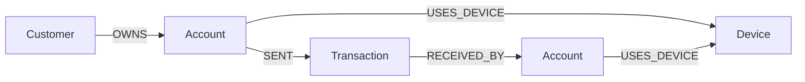

# Modelo do grafo (Neo4j) e consultas Cypher

## 1. Convenções

- Todo nó tem `id` (UUID do **modelo canônico**) e `pgId` (chave primária no PostgreSQL). O mapeamento completo de IDs será detalhado no documento do modelo canônico (28–29/11).
- Nomes de rótulos em `PascalCase`, relacionamentos em `SNAKE_CASE`, propriedades em `camelCase`.
- Datas como `datetime` do Neo4j.

## 2. Nós

| Rótulo | Propriedades | Observação |
|---|---|---|
| `Customer` | `id`, `pgId`, `name`, `document`, `createdAt` | Titular de uma ou mais contas |
| `Account` | `id`, `pgId`, `number`, `status`, `openedAt` | Origem e destino de transações |
| `Device` | `id`, `pgId`, `fingerprint`, `os`, `firstSeenAt` | Dispositivo usado para acessar contas |
| `Transaction` | `id`, `pgId`, `amount`, `currency`, `timestamp`, `channel`, `score`, `decision` | `decision` ∈ {APROVAR, REVISAR, BLOQUEAR}; `score` e `decision` são preenchidos pela avaliação |

## 3. Relacionamentos

| Relacionamento | Direção | Propriedades |
|---|---|---|
| `OWNS` | `(Customer)-[:OWNS]->(Account)` | `since` |
| `USES_DEVICE` | `(Account)-[:USES_DEVICE]->(Device)` | `firstSeen`, `lastSeen` |
| `SENT` | `(Account)-[:SENT]->(Transaction)` | — |
| `RECEIVED_BY` | `(Transaction)-[:RECEIVED_BY]->(Account)` | — |

Uma transferência da conta A para a conta B fica assim:

```
(A:Account)-[:SENT]->(t:Transaction)-[:RECEIVED_BY]->(B:Account)
```

Com a transação como nó, o resultado da avaliação (`score`, `decision`) fica guardado no próprio nó e o caminho entre contas passa sempre por um `Transaction`, o que dá **dois saltos por transferência** nas consultas de ciclo.

### Diagrama



## 4. Mapeamento com o modelo relacional

| PostgreSQL (JPA) | Neo4j |
|---|---|
| tabela `customer` | nó `Customer` |
| tabela `account` (FK `customer_id`, 1:N) | nó `Account` + relacionamento `OWNS` |
| tabela `device` | nó `Device` |
| tabela associativa conta–dispositivo (N:M) | relacionamento `USES_DEVICE` |
| tabela `transaction` (FK origem e destino) | nó `Transaction` + `SENT` + `RECEIVED_BY` |

> Ajustar os nomes das tabelas quando o diagrama de classes estiver pronto.

## 5. Restrições e índices

```cypher
CREATE CONSTRAINT customer_id IF NOT EXISTS FOR (n:Customer)    REQUIRE n.id IS UNIQUE;
CREATE CONSTRAINT account_id  IF NOT EXISTS FOR (n:Account)     REQUIRE n.id IS UNIQUE;
CREATE CONSTRAINT device_id   IF NOT EXISTS FOR (n:Device)      REQUIRE n.id IS UNIQUE;
CREATE CONSTRAINT tx_id       IF NOT EXISTS FOR (n:Transaction) REQUIRE n.id IS UNIQUE;

CREATE CONSTRAINT device_fingerprint IF NOT EXISTS FOR (n:Device) REQUIRE n.fingerprint IS UNIQUE;

CREATE INDEX tx_timestamp IF NOT EXISTS FOR (n:Transaction) ON (n.timestamp);
CREATE INDEX account_pgid IF NOT EXISTS FOR (n:Account)     ON (n.pgId);
```

As restrições de unicidade em `id` são o que permite ao integrador usar `MERGE` de forma **idempotente**.

## 6. Escrita idempotente (usada pelo integrador)

```cypher
// Conta (parâmetros: $id, $pgId, $number, $status, $customerId)
MERGE (a:Account {id: $id})
  ON CREATE SET a.openedAt = datetime()
SET a.pgId = $pgId, a.number = $number, a.status = $status
WITH a
MATCH (c:Customer {id: $customerId})
MERGE (c)-[:OWNS]->(a);

// Transação (parâmetros: $id, $pgId, $amount, $currency, $timestamp, $channel, $originId, $destId)
MERGE (t:Transaction {id: $id})
SET t.pgId = $pgId, t.amount = $amount, t.currency = $currency,
    t.timestamp = datetime($timestamp), t.channel = $channel
WITH t
MATCH (o:Account {id: $originId}), (d:Account {id: $destId})
MERGE (o)-[:SENT]->(t)
MERGE (t)-[:RECEIVED_BY]->(d);

// Uso de dispositivo (parâmetros: $accountId, $deviceId, $fingerprint, $seenAt)
MERGE (dv:Device {id: $deviceId})
  ON CREATE SET dv.fingerprint = $fingerprint, dv.firstSeenAt = datetime($seenAt)
WITH dv
MATCH (a:Account {id: $accountId})
MERGE (a)-[u:USES_DEVICE]->(dv)
  ON CREATE SET u.firstSeen = datetime($seenAt)
SET u.lastSeen = datetime($seenAt);
```

## 7. Consultas de investigação

### 7.1 Dispositivos compartilhados

Dispositivos usados por duas ou mais contas (`$minContas`, padrão 2):

```cypher
MATCH (d:Device)<-[:USES_DEVICE]-(a:Account)
WITH d, collect(DISTINCT a) AS contas
WHERE size(contas) >= $minContas
RETURN d.fingerprint AS dispositivo,
       size(contas)  AS qtdContas,
       [c IN contas | c.id] AS contas
ORDER BY qtdContas DESC;
```

Contas ligadas a um dispositivo suspeito, com seus titulares:

```cypher
MATCH (d:Device {fingerprint: $fingerprint})<-[:USES_DEVICE]-(a:Account)
OPTIONAL MATCH (c:Customer)-[:OWNS]->(a)
RETURN a.id AS conta, a.number AS numero, c.name AS titular;
```

### 7.2 Ciclos de transferência

Dinheiro que sai de uma conta e volta para ela passando por 3 a 5 contas, dentro de uma janela de tempo (`$dias`). Cada transferência ocupa 2 saltos, por isso `*6..10`:

```cypher
MATCH p = (a:Account)-[:SENT|RECEIVED_BY*6..10]->(a)
WITH p, [n IN nodes(p) WHERE n:Account]     AS contas,
        [n IN nodes(p) WHERE n:Transaction] AS txs
WHERE all(t IN txs WHERE t.timestamp >= datetime() - duration({days: $dias}))
  AND size(contas) - 1 = size(reduce(s = [], x IN contas[1..] |
                                     CASE WHEN x IN s THEN s ELSE s + x END))
RETURN [c IN contas | c.id] AS ciclo,
       size(txs)            AS qtdTransferencias,
       reduce(total = 0.0, t IN txs | total + t.amount) AS valorTotal
ORDER BY valorTotal DESC
LIMIT 50;
```

O filtro com `reduce` descarta caminhos que repetem uma conta no meio do ciclo, mantendo só ciclos simples.

### 7.3 Redes de contas-laranja

Contas que recebem de muitas origens e repassam quase tudo rapidamente. Parâmetros sugeridos: `$desde` (data inicial), `$minOrigens` = 5, `$razaoRepasse` = 0.8:

```cypher
MATCH (a:Account)
OPTIONAL MATCH (a)<-[:RECEIVED_BY]-(tin:Transaction)
  WHERE tin.timestamp >= $desde
WITH a, count(DISTINCT tin) AS qtdEntradas,
        coalesce(sum(tin.amount), 0.0) AS totalEntrada
WHERE qtdEntradas >= $minOrigens
OPTIONAL MATCH (a)-[:SENT]->(tout:Transaction)
  WHERE tout.timestamp >= $desde
WITH a, qtdEntradas, totalEntrada, coalesce(sum(tout.amount), 0.0) AS totalSaida
WHERE totalEntrada > 0 AND totalSaida / totalEntrada >= $razaoRepasse
RETURN a.id AS conta, qtdEntradas, totalEntrada, totalSaida,
       totalSaida / totalEntrada AS razaoRepasse
ORDER BY qtdEntradas DESC;
```

Rede ao redor de uma conta suspeita (2 níveis de transferências e dispositivos):

```cypher
MATCH (a:Account {id: $contaId})
OPTIONAL MATCH p1 = (a)-[:SENT|RECEIVED_BY*1..4]-(:Account)
OPTIONAL MATCH p2 = (a)-[:USES_DEVICE]->(:Device)<-[:USES_DEVICE]-(:Account)
RETURN a, p1, p2;
```

### 7.4 Consultas de apoio ao motor de risco

Velocidade: transações enviadas pela conta na última hora (`$contaId`):

```cypher
MATCH (:Account {id: $contaId})-[:SENT]->(t:Transaction)
WHERE t.timestamp >= datetime() - duration({hours: 1})
RETURN count(t) AS qtd, coalesce(sum(t.amount), 0.0) AS total;
```

Conta usa dispositivo compartilhado com outras contas?

```cypher
MATCH (:Account {id: $contaId})-[:USES_DEVICE]->(d:Device)<-[:USES_DEVICE]-(o:Account)
WHERE o.id <> $contaId
RETURN count(DISTINCT o) AS outrasContas;
```

Gravar o resultado da avaliação:

```cypher
MATCH (t:Transaction {id: $txId})
SET t.score = $score, t.decision = $decision, t.evaluatedAt = datetime()
RETURN t.id, t.decision;
```

